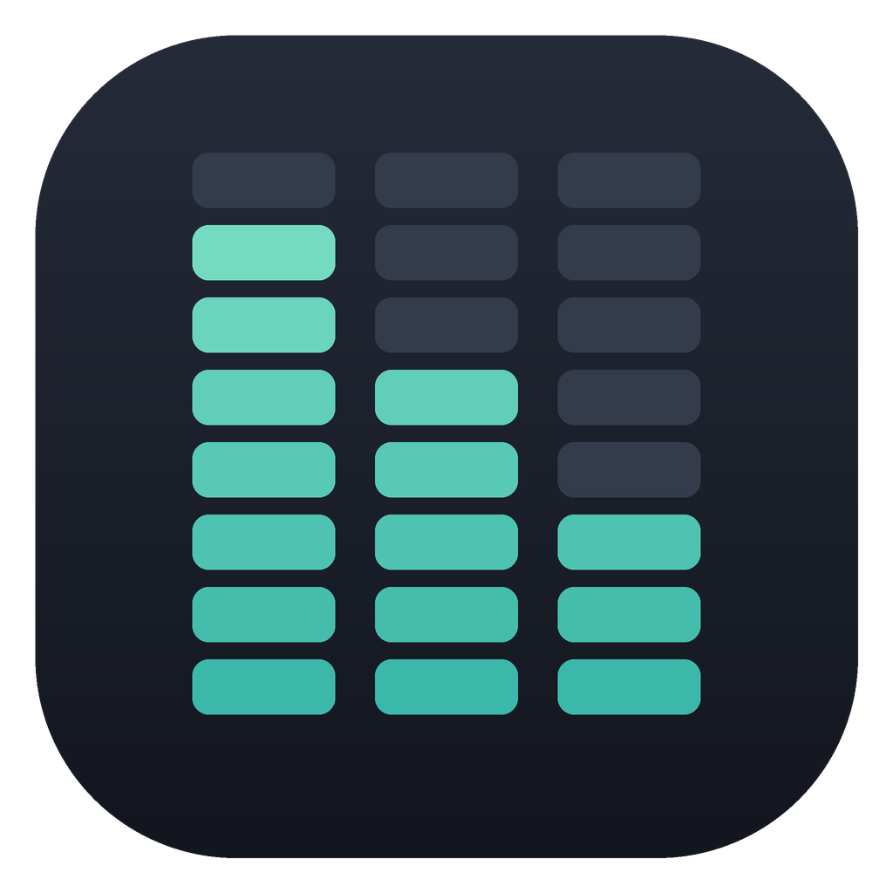
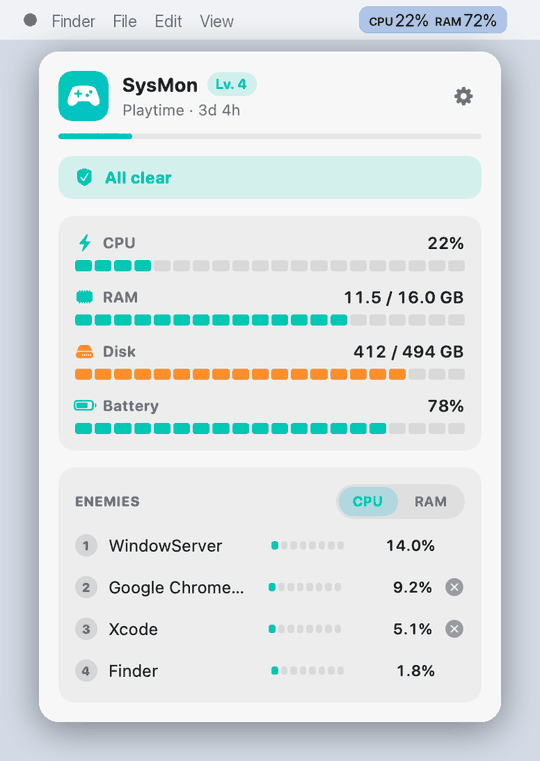

<div align="center">



# SysMon

**Your Mac's vitals, as a game HUD — right in the menu bar.**
<br>
<sub>Mac'inin sağlığı, menü çubuğunda bir oyun arayüzü olarak.</sub>

<br>

<picture>
  <source media="(prefers-color-scheme: dark)" srcset="assets/demo-en-dark.gif">
  
</picture>

<br><br>

[](https://github.com/ozkurtomer/sysmon/releases/latest)
[](https://github.com/ozkurtomer/sysmon/releases)
[](https://github.com/ozkurtomer/sysmon/actions/workflows/build.yml)


[](LICENSE)

**English** · [Türkçe](README.tr.md)

[**Download**](https://github.com/ozkurtomer/sysmon/releases/latest) · [Report a bug](https://github.com/ozkurtomer/sysmon/issues/new/choose) · [Ideas](https://github.com/ozkurtomer/sysmon/discussions)

</div>

---

## Why SysMon?

Activity Monitor is powerful, but it's a whole window of numbers. SysMon turns the same information into something you can read in half a second — a tiny HUD in your menu bar that tells you *how your Mac is doing* and *who's to blame* when it isn't.

- **Glanceable.** `CPU 23%  RAM 72%` lives in the menu bar and turns red when things get tight.
- **Playful, not noisy.** Segmented gauges, a status banner, and your heaviest apps as "enemies" — with a **BOSS** tag for the one hogging the machine.
- **Light on resources.** Native Swift/SwiftUI, no dependencies. Idle usage is around 0.4% CPU and ~45 MB.
- **Private.** Everything is computed locally. No network access, no analytics, no accounts.

## Features

| | |
| --- | --- |
| **Live menu bar readout** | CPU and RAM, refreshed every 2 seconds, turns red under pressure |
| **Game-style HUD** | Segmented gauges for CPU, RAM, Disk and Battery |
| **Status banner** | *All clear* → *Enemies nearby* → *Boss fight!* / *Low health!* |
| **Enemies list** | Top apps by CPU or RAM, with a BOSS badge for the worst offender |
| **Defeat button** | Politely ask a misbehaving app to quit (it will still ask to save your work) |
| **Level & XP** | Your Mac levels up with every day of uptime ("playtime") |
| **Follows your Mac** | Automatic light / dark appearance and your system language |
| **Languages** | English and Türkçe — switch any time from ⚙︎ → Language |
| **Launch at login** | One click from the ⚙︎ menu |

## How the game maps to your Mac

| In the game | On your Mac |
| --- | --- |
| ⚡ **CPU gauge** | Overall CPU usage |
| 🧠 **RAM gauge** | Active + wired + compressed memory vs. installed RAM |
| 💾 **Disk gauge** | Used space on the startup volume |
| 🔋 **Battery gauge** | Charge level (shown on laptops) |
| 👾 **Enemies** | The apps using the most CPU or memory right now |
| 👑 **BOSS** | An app using ≥ 30% CPU (or a huge share of RAM) |
| 🎮 **Level / playtime** | Days since last boot (Lv. 1 = first day) |
| ❤️ **Low health!** | RAM usage above 92% |

> macOS deliberately keeps RAM and disk fairly full, so gauges only turn orange above 80% and red above 92%.

## Install

1. Download **`SysMon.dmg`** from the [latest release](https://github.com/ozkurtomer/sysmon/releases/latest).
2. Open it and drag **SysMon** into **Applications**.
3. First launch only: **right-click SysMon → Open → Open**.

> SysMon is ad-hoc signed but not notarized (that requires a paid Apple Developer account), so macOS asks you to confirm once. Prefer to verify? The whole app is ~700 lines of Swift in [`Sources/`](Sources) — or build it yourself below.

**Requirements:** macOS 13 Ventura or later · Apple Silicon or Intel.

## Build from source

You need the Xcode Command Line Tools (`xcode-select --install`).

```bash
git clone https://github.com/ozkurtomer/sysmon.git
cd sysmon
./scripts/build.sh          # universal .app + DMG in ./build
open build/SysMon.app
```

Regenerate the README animations from the real SwiftUI view with `./scripts/make-media.sh` (needs `pip install pillow`).

## How it works

| Metric | Source |
| --- | --- |
| CPU | `host_statistics` tick deltas between refreshes |
| RAM | `host_statistics64` — active + wired + compressor pages |
| Disk | `URLResourceValues` on `/` (important-usage capacity) |
| Battery | IOKit `IOPSCopyPowerSourcesInfo` |
| Top apps | `ps`, sorted by CPU / memory — fetched only while the panel is open |

The panel is a SwiftUI view hosted in an `NSPopover`, so light/dark mode and vibrancy come straight from macOS.

## Roadmap

Ideas that would make great contributions — pick one and open a PR:

- [ ] More languages (add a dictionary in [`Strings.swift`](Sources/Strings.swift) — it's ~25 lines)
- [ ] GPU and network gauges
- [ ] Temperature / fan readout (Apple Silicon sensors)
- [ ] Achievements & streaks ("Calm Seas: 1 hour under 10% CPU")
- [ ] Alternative HUD themes (retro pixel, minimal)
- [ ] Notarized builds & a Homebrew cask

Browse [`good first issue`](https://github.com/ozkurtomer/sysmon/labels/good%20first%20issue) for starter tasks.

## Contributing

Contributions of every size are welcome — code, translations, design, docs, bug reports. Start with [CONTRIBUTING.md](CONTRIBUTING.md); please also read the [Code of Conduct](CODE_OF_CONDUCT.md).

<a href="https://github.com/ozkurtomer/sysmon/graphs/contributors">
  
</a>

## Support the project

If SysMon is useful to you, a ⭐ **star** helps other people find it — thank you!

[](https://star-history.com/#ozkurtomer/sysmon&Date)

## License

[MIT](LICENSE) © 2026 [Ömer Özkurt](https://github.com/ozkurtomer)
