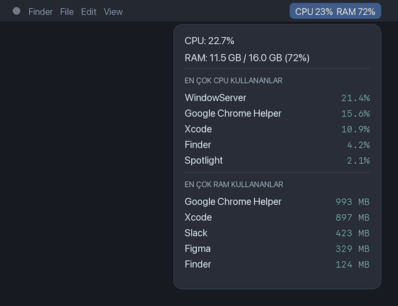

<div align="center">

# SysMon

**A quiet little menu bar monitor for your Mac.**
Live CPU and RAM at a glance — and what's eating them, one click away.



<br>

[](https://github.com/ozkurtomer/sysmon/actions/workflows/build.yml)


[](LICENSE)

[Türkçe](README.tr.md)

</div>

---

## Why

Activity Monitor is great, but it's a whole window. SysMon lives in your menu bar, uses almost nothing itself, and answers one question fast: *what is slowing my Mac down right now?*

## Features

- **Live numbers in the menu bar** — `CPU 22%  RAM 72%`, refreshed every 2 seconds
- **Top 5 processes** by CPU and by memory, in a single dropdown
- **Native and tiny** — one Swift file, no dependencies, no Dock icon
- **Universal** — runs on Apple Silicon and Intel
- **Launch at login** — one checkbox in the menu
- **Jump to Activity Monitor** when you need the full picture

## Install

1. Download **`SysMon.dmg`** from the [latest release](https://github.com/ozkurtomer/sysmon/releases/latest).
2. Open it and drag **SysMon** into **Applications**.
3. First launch only: **right-click SysMon → Open → Open**.

> The app is ad-hoc signed, not notarized, so macOS asks for confirmation once. After that it opens normally.

## Build from source

You need macOS 13+ and the Xcode Command Line Tools (`xcode-select --install`).

```bash
git clone https://github.com/ozkurtomer/sysmon.git
cd sysmon
./scripts/build.sh
open build/SysMon.app
```

The script compiles for both architectures, assembles the `.app` bundle, signs it ad-hoc, and packs `build/SysMon.dmg`.

## How it works

| Metric | Source |
| --- | --- |
| CPU | `host_statistics` tick deltas between refreshes |
| RAM | `host_statistics64` — active + wired + compressed pages |
| Top processes | `ps`, sorted by CPU / memory |

Everything runs locally. SysMon makes no network connections and collects nothing.

## Project layout

```
Sources/main.swift          the whole app
scripts/build.sh            universal .app + DMG
assets/make_demo_gif.py     regenerates the README animation
.github/workflows/          CI build, release on tag
```

## Contributing

Issues and pull requests are welcome — see [CONTRIBUTING.md](CONTRIBUTING.md).

## License

[MIT](LICENSE) © Ömer Özkurt
