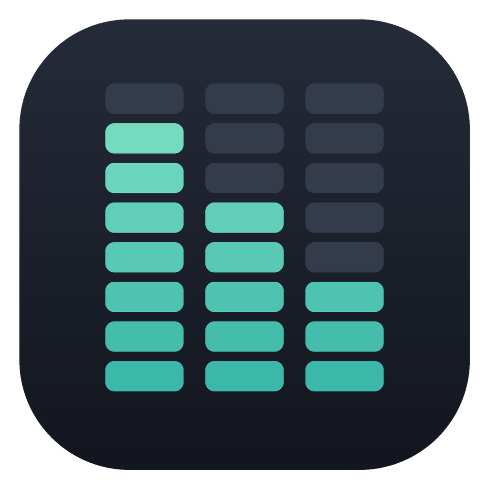
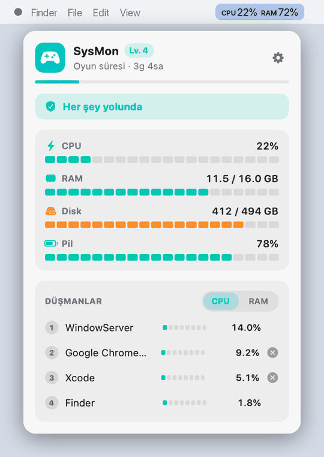

<div align="center">



# SysMon

**Mac'inin sağlığı, menü çubuğunda bir oyun arayüzü olarak.**
<br>
<sub>Your Mac's vitals, as a game HUD — right in the menu bar.</sub>

<br>

<picture>
  <source media="(prefers-color-scheme: dark)" srcset="assets/demo-tr-dark.gif">
  
</picture>

<br><br>

[](https://github.com/ozkurtomer/sysmon/releases/latest)
[](https://github.com/ozkurtomer/sysmon/releases)
[](https://github.com/ozkurtomer/sysmon/actions/workflows/build.yml)


[](LICENSE)

[English](README.md) · **Türkçe**

[**İndir**](https://github.com/ozkurtomer/sysmon/releases/latest) · [Hata bildir](https://github.com/ozkurtomer/sysmon/issues/new/choose) · [Fikirler](https://github.com/ozkurtomer/sysmon/discussions)

</div>

---

## Neden SysMon?

Etkinlik Monitörü güçlü ama tam bir sayı penceresi. SysMon aynı bilgiyi yarım saniyede okunacak hale getirir: menü çubuğunda duran küçük bir oyun arayüzü; *Mac'in nasıl gidiyor* ve işler kötüleşince *kim suçlu* sorusunu cevaplar.

- **Tek bakışta.** `CPU 23%  RAM 72%` menü çubuğunda durur, sıkışınca kırmızıya döner.
- **Eğlenceli ama gürültüsüz.** Segmentli göstergeler, durum bandı ve en çok kaynak yiyen uygulamalar "düşman" olarak listelenir; makineyi yoran için **BOSS** etiketi çıkar.
- **Hafif.** Yerel Swift/SwiftUI, bağımlılık yok. Boştayken yaklaşık %0,4 CPU ve ~45 MB.
- **Gizli.** Her şey yerelde hesaplanır. Ağ erişimi, analitik ya da hesap yok.

## Özellikler

| | |
| --- | --- |
| **Canlı menü çubuğu değeri** | CPU ve RAM, 2 saniyede bir yenilenir, sıkışınca kırmızı olur |
| **Oyun tarzı HUD** | CPU, RAM, Disk ve Pil için segmentli göstergeler |
| **Durum bandı** | *Her şey yolunda* → *Düşmanlar yakında* → *Boss savaşı!* / *Can azalıyor!* |
| **Düşman listesi** | CPU veya RAM'e göre en çok kullanan uygulamalar, en kötüsüne BOSS rozeti |
| **Yen butonu** | Sorun çıkaran uygulamadan nazikçe kapanmasını iste (kaydedilmemiş iş için yine sorar) |
| **Seviye ve XP** | Mac'in her açık kaldığı günle seviye atlar ("oyun süresi") |
| **Mac'ine uyar** | Otomatik açık / koyu tema ve sistem dili |
| **Diller** | English ve Türkçe — ⚙︎ → Dil menüsünden istediğin zaman değiştir |
| **Girişte başlat** | ⚙︎ menüsünden tek tık |

## Oyun, Mac'inle nasıl eşleşiyor?

| Oyunda | Mac'te |
| --- | --- |
| ⚡ **CPU göstergesi** | Toplam işlemci kullanımı |
| 🧠 **RAM göstergesi** | Aktif + wired + sıkıştırılmış bellek / kurulu RAM |
| 💾 **Disk göstergesi** | Başlangıç diskinde kullanılan alan |
| 🔋 **Pil göstergesi** | Şarj seviyesi (dizüstülerde görünür) |
| 👾 **Düşmanlar** | Şu an en çok CPU veya bellek kullanan uygulamalar |
| 👑 **BOSS** | %30 ve üzeri CPU kullanan (veya RAM'in büyük kısmını tutan) uygulama |
| 🎮 **Seviye / oyun süresi** | Son açılıştan bu yana geçen gün (Lv. 1 = ilk gün) |
| ❤️ **Can azalıyor!** | RAM kullanımı %92'nin üzerinde |

> macOS, RAM ve diski bilerek oldukça dolu tutar; bu yüzden göstergeler %80'in üstünde turuncu, %92'nin üstünde kırmızı olur.

## Kurulum

### Seçenek 1 — Tek komut (önerilen)

**Terminal**'i aç ve yapıştır:

```bash
curl -fsSL https://raw.githubusercontent.com/ozkurtomer/sysmon/main/scripts/install.sh | bash
```

Son sürümü indirir, SysMon'u **Applications**'a kurar ve açar — **güvenlik uyarısı çıkmaz**, çünkü bu yolla inen dosyalara macOS karantina işareti koymaz. Betik [kısa ve okunabilir](scripts/install.sh).

### Seçenek 2 — DMG indir

1. [Son sürümden](https://github.com/ozkurtomer/sysmon/releases/latest) **`SysMon.dmg`** dosyasını indir ve **SysMon**'u **Applications**'a sürükle.
2. SysMon'u aç. macOS *"Apple, SysMon'un kötü amaçlı yazılım içermediğini doğrulayamadı"* derse **Bitti**'ye tıkla (*Çöp Sepetine Taşı*'ya değil), sonra:
   - **macOS 15 Sequoia ve sonrası:** Sistem Ayarları → **Gizlilik ve Güvenlik** → *Güvenlik* bölümüne kaydır → SysMon'un yanındaki **Yine de Aç** → parolanla onayla.
   - **macOS 13–14:** SysMon'a sağ tık → **Aç** → **Aç**.
   - **Ya da Terminal'de** (her sürümde): `xattr -dr com.apple.quarantine /Applications/SysMon.app`

> **Uyarı neden çıkıyor?** SysMon açık kaynak ve ad-hoc imzalı ama *notarize* değil — Apple yalnızca ücretli Developer hesabı (yılda 99 $) olan uygulamaları notarize eder. Uyarı uygulamanın ne yaptığıyla değil, bu eksik evrakla ilgili. Her satırı [`Sources/`](Sources) içinde okuyabilir ya da aşağıdan kendin derleyebilirsin.

**Gereksinimler:** macOS 13 Ventura veya üzeri · Apple Silicon veya Intel.

## Kaynaktan derleme

Xcode Command Line Tools gerekir (`xcode-select --install`).

```bash
git clone https://github.com/ozkurtomer/sysmon.git
cd sysmon
./scripts/build.sh          # ./build içinde universal .app + DMG
open build/SysMon.app
```

README animasyonlarını gerçek SwiftUI görünümünden yeniden üretmek için `./scripts/make-media.sh` (önce `pip install pillow`).

## Nasıl çalışır?

| Ölçüm | Kaynak |
| --- | --- |
| CPU | Yenilemeler arası `host_statistics` tick farkı |
| RAM | `host_statistics64` — aktif + wired + sıkıştırıcı sayfalar |
| Disk | `/` üzerinde `URLResourceValues` |
| Pil | IOKit `IOPSCopyPowerSourcesInfo` |
| En çok kullananlar | `ps` ile CPU / belleğe göre — sadece panel açıkken çalışır |

Panel, `NSPopover` içinde bir SwiftUI görünümüdür; açık/koyu tema ve saydamlık doğrudan macOS'tan gelir.

## Yol haritası

Harika katkılar olabilecek fikirler — birini seç ve PR aç:

- [ ] Daha fazla dil ([`Strings.swift`](Sources/Strings.swift) içine ~25 satırlık sözlük eklemek yeterli)
- [ ] GPU ve ağ göstergeleri
- [ ] Sıcaklık / fan bilgisi (Apple Silicon sensörleri)
- [ ] Başarımlar ve seriler ("Sakin Sular: 1 saat %10 altı CPU")
- [ ] Alternatif HUD temaları (retro piksel, minimal)
- [ ] Notarize edilmiş sürümler ve Homebrew cask

Başlangıç görevleri için [`good first issue`](https://github.com/ozkurtomer/sysmon/labels/good%20first%20issue) etiketine bak.

## Katkıda bulunma

Her boyutta katkıya açığız: kod, çeviri, tasarım, dokümantasyon, hata bildirimi. [CONTRIBUTING.md](CONTRIBUTING.md) ile başla; [Davranış Kuralları](CODE_OF_CONDUCT.md)'nı da oku.

<a href="https://github.com/ozkurtomer/sysmon/graphs/contributors">
  
</a>

## Projeyi destekle

SysMon işine yaradıysa ⭐ **yıldız** vermen başkalarının da bulmasına yardım eder — teşekkürler!

[](https://star-history.com/#ozkurtomer/sysmon&Date)

## Lisans

[MIT](LICENSE) © 2026 [Ömer Özkurt](https://github.com/ozkurtomer)
